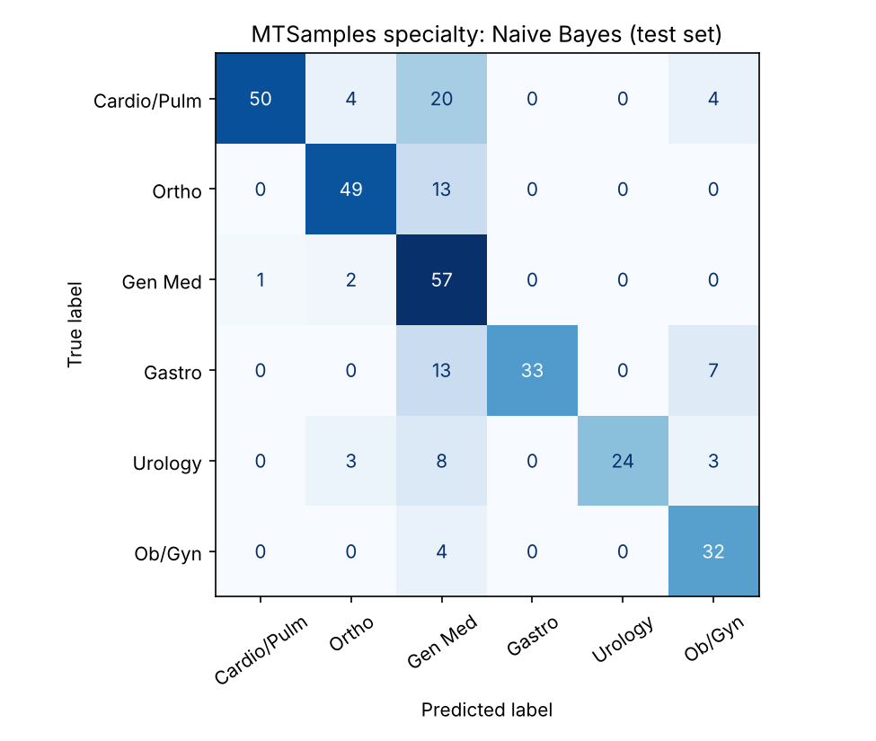

# Classic NLP for Clinical Text: Regex, Bigram Models and Naive Bayes

Rule-based extraction, a bigram language model and a Naive Bayes classifier, built from scratch and tested on clinical notes.

Originally developed during my postgraduate study in Artificial Intelligence, then extended to clinical text.

## Why classic NLP still matters for clinical text

These methods are **transparent**: you can read a regex or a list of top words and see why a note was flagged. They're **cheap**: each notebook ran in under a minute in my tests, with no data leaving the machine. And they're an honest **baseline** that shows how much a transformer actually adds.

## Data

| Dataset | Used in | Size | Licence |
|---|---|---|---|
| NLTK Gutenberg (Shakespeare, Austen) | Part A | 6 works | Public domain |
| Fake or real news (G. McIntire) | Part A | 6,335 articles | Not stated |
| [MTSamples](https://www.kaggle.com/datasets/tboyle10/medicaltranscriptions) | Part B | 4,999 rows, 2,357 unique notes | CC0 (scraped from mtsamples.com) |
| [Medical Abstracts](https://github.com/sebischair/Medical-Abstracts-TC-Corpus) | Part B | 14,438 abstracts | CC BY-SA 3.0 |

No data is stored here. See [`data/README.md`](data/README.md) for downloads.

## Methods

**Part A** ([notebook](notebooks/01_original_methods.ipynb)):
- a regex chatbot;
- bigram language models with add-one (Laplace) smoothing for Shakespeare vs Austen attribution;
- Naive Bayes on binary bag-of-words features for fake vs real news.

**Part B** ([notebook](notebooks/02_clinical_text.ipynb)) reuses the same code in `src/`:
- **Regex** extraction of doses, blood pressure, heart rate, temperature and dates, with 50 matches hand-checked for precision.
- **Bigram model** trained on clinical notes (size matched to the Austen corpus), compared with the Part A models by perplexity.
- **Naive Bayes** specialty classifier. Identical notes are de-duplicated, and document-type labels and multi-specialty notes are dropped. That leaves the 6 most common specialties (1,087 notes), split 70/30 (stratified, seed 42), with a majority-class baseline. I repeated the pipeline on Medical Abstracts.

## Results

**Part A: general text**

| Task | Metric | Value |
|---|---|---|
| Authorship (5,541 held-out sentences) | Accuracy | 0.958 |
| Fake vs real news | Accuracy / macro F1 | 0.624 / 0.562 |

**Part B: clinical text**

| Analysis | Metric | Model | Majority baseline |
|---|---|---|---|
| Regex extraction | Precision | 0.96 (95% CI 0.87–0.99) | n/a |
| MTSamples specialty (6 classes) | Accuracy / macro F1 | 0.749 / 0.761 | 0.239 / 0.064 |
| Medical Abstracts (5 classes) | Accuracy / macro F1 | 0.533 / 0.524 | 0.333 / 0.100 |

**Domain shift.** The clinical bigram model has a perplexity of 1,014 on held-out notes, but 4,338–5,571 on the novels, which is worse than either literary model ([full table](results/partB_perplexity.csv)). Sentences it generated:

> during dobutamine stress test for hemostasis .
> 2 was retracted from the results and tear on the visit .



General Medicine absorbs many errors. Per-class metrics and top words are in [`results/`](results/).

## Limitations

- **Label noise and overlapping specialties.** I kept only single-specialty notes (1,087 of 2,357), a selected subset. Performance on all notes would probably be lower.
- **Not real EHR notes.** Transcription samples are tidier than real notes, which are full of abbreviations, templates and copy-forward text.
- **Single dataset, no external validation.** Medical Abstracts has different labels, so it tests the method, not the model.
- **Class imbalance and small numbers.** There are 36–78 test notes per specialty, so per-class estimates are imprecise.
- **Regex brittleness.** The patterns miss shorthand ("T 98", "P 84") and mistake weights or pain scores for doses or dates. Recall wasn't measured, and only one reviewer checked the matches.

## Next steps

- Compare with a transformer model such as ClinicalBERT on the same splits.
- Externally validate on another labelled clinical-note dataset.
- Measure regex recall on an annotated sample, and add negation handling.

## How to run

```bash
git clone https://github.com/Yayehirad/classic-nlp-clinical-text.git
cd classic-nlp-clinical-text
pip install -r requirements.txt   # NLTK pinned to 3.9.1 for reproducible tokenisation
# add the data files to data/ (see data/README.md)
jupyter notebook notebooks/
```
